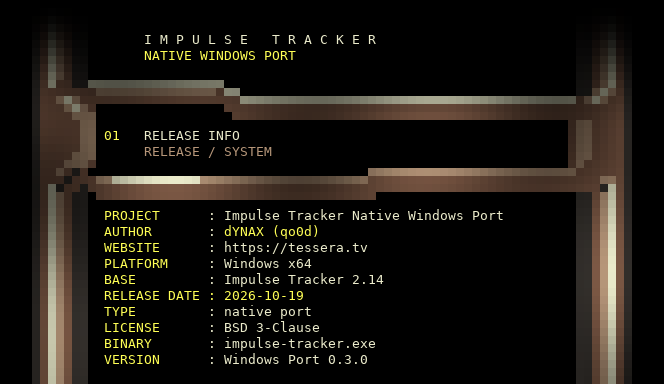
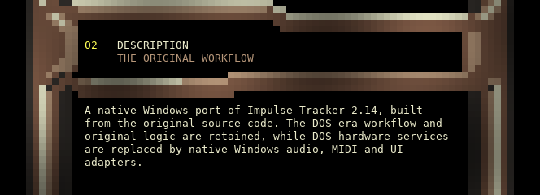
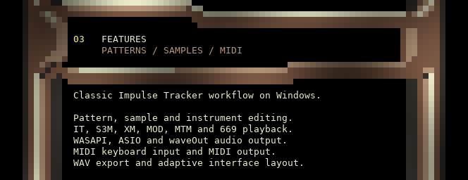
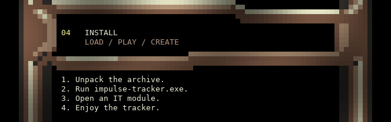
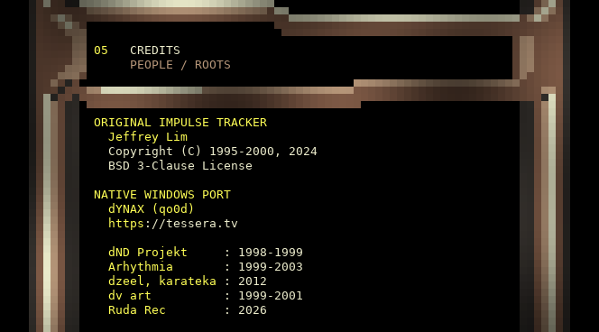
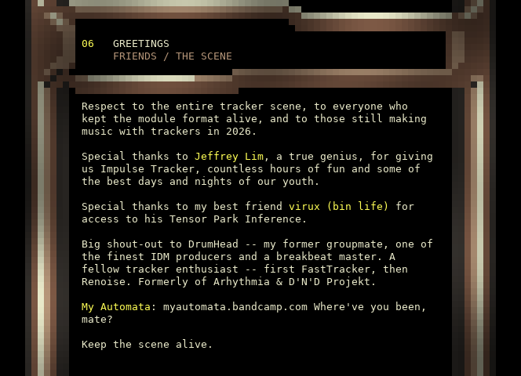
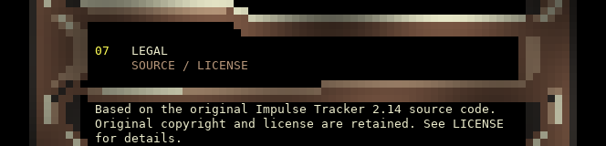
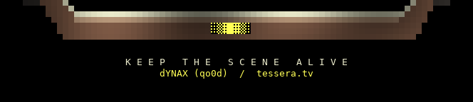

  

<strong>dYNAX presents</strong>

<h1 align="center">Impulse Tracker</h1>

<strong>Native Windows Port</strong>

> **Press Ctrl+Shift+G to switch between Classic and HQ (Hi-Res). Try both!**

**Windows audio: WASAPI · ASIO · waveOut. Render WAV · selectable interpolation · LUFS-S metering.**

[Read the project information](README-TEXT.md) · [Changelog](CHANGELOG.md) · [Release notes](RELEASE-NOTES.md)

  

Download the Windows application from this repository’s **Releases** page.

  

  

[Audio backends, interpolation and WAV export](README-TEXT.md#native-windows-audio-and-wav-rendering)

  

[Download and launch instructions](README-TEXT.md#download-and-run) · **Classic / HQ: Ctrl+Shift+G**

  

  

  

  

[Colour ANSI](tessera-portrait.ans) · [Text NFO](tessera-portrait.nfo) · [License](LICENSE) · [Artwork](ARTWORK.txt)
