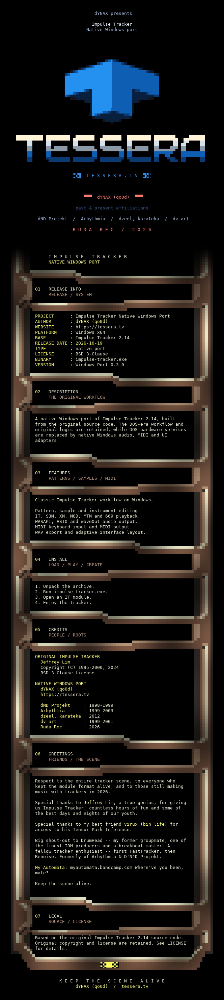

<strong>dYNAX presents</strong>

<h1 align="center">Impulse Tracker — Native Windows Port</h1>

A native Windows port of Impulse Tracker 2.14, with Classic and HQ interfaces, Windows audio and MIDI, and WAV export.

<strong><a href="https://github.com/qo0d/impulse-tracker-win/releases/latest">DOWNLOAD</a></strong>

Extract the ZIP and run `impulse-tracker.exe`. 
Press **Ctrl+Shift+G** to switch between Classic and HQ.

## Features

- WASAPI, ASIO and waveOut audio output.
- Nearest, Linear, Cubic and Sinc8 interpolation.
- LUFS-S and peak metering.
- Stereo WAV export.
- Windows MIDI input and output.
- Music-reactive Demo and ANSI/NFO viewer.

  

[Getting started](README-TEXT.md#download-and-run) · [Changelog](CHANGELOG.md) · [Release notes](RELEASE-NOTES.md) · [Credits](README-TEXT.md#credits-and-license)
